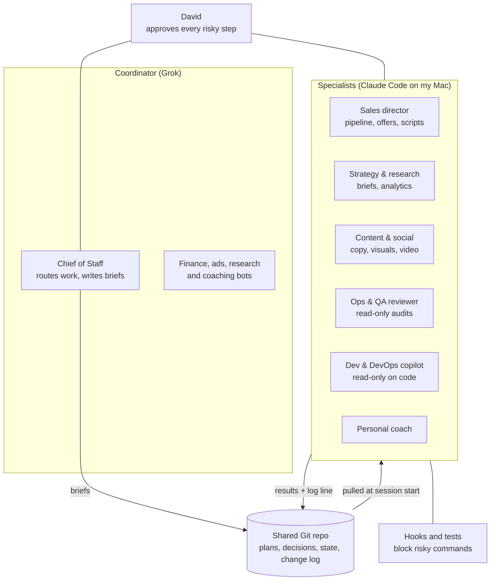

# AI Agent System (RUFO)

A small team of specialised AI agents that helps me run several businesses at once: research, sales, content, operations, engineering support and personal coaching. The hard part was not making the agents capable. It was making them safe enough to trust with real customers, real money and production systems.

## Problem

One person running a SaaS company, a consulting practice and a sales role produces more work than fits in a day. A single general-purpose assistant forgets context between sessions, states things it never checked, and will happily send a message or run a deploy if asked the wrong way. I needed specialists with narrow permissions, a shared memory, and guardrails that do not depend on the model remembering a rule.

## Architecture



### Agents

| Agent | Role | Permissions |
|---|---|---|
| Chief of Staff | Single router: decides who owns a request and writes a brief for it | Writes to the shared repo only |
| Sales director | Pipeline review, forecasting, offers within the price list, call prep, scripts for the sales team | Drafts only: never sends a message |
| Strategy & research | Weekly research brief, competitor analysis, campaign briefs, analytics reports | Read + write notes, web research |
| Content & social | Posts, carousels, short video for Instagram and Threads, from the strategy brief | Writes drafts; publishing is manual |
| Ops & QA reviewer | Weekly audit of the other agents, and QA of every piece of content before it is published | Read-only |
| Dev & DevOps copilot | Incident triage, error-feed triage (each issue classed as ghost, noise, bug or efficiency), pre-deploy checks | Read-only on code; proposes diffs as text, never merges or deploys |
| Finance, ads, research bots | Cash and billing reconciliation, ad monitoring, on-demand research | Run on the coordinator side |
| Personal coach | Weekly personal check-in, separate from business | Its own notes only |

Every new agent starts in **calibration**: for at least two weeks it runs on demand and I approve each write one by one. Permissions are enforced by tooling (the tool list in each agent's definition), never by asking the model nicely.

## Guardrails

**1. A written doctrine with a permission matrix.**

- 🟢 Go: copy, CSS, non-breaking refactors, bug fixes with a reproduction, read-only analysis.
- 🟡 Do, then report: cosmetic pushes, minor dependency updates.
- 🔴 Ask first: production merges, database migrations, environment variables, any spending, messages to real people, legal.

Every claim about the state of a system carries a label: verified (two sources), inferred, assumed, opinion or data.

**2. Hooks that physically block risky actions.** Rules that can be enforced in code are enforced in code. Shell hooks run before every command the agents issue and block, for example:

- destructive git (hard resets, force pushes, recursive deletes) and any production deploy of Tab & Eat without the technical lead's review;
- infrastructure CLI commands that look like reads but write, born from a real incident where a "read" command created a public domain;
- relative paths after `cd`, which the permission checker cannot resolve;
- a memory index that grows into a document instead of staying a list of pointers;
- a git push that contains a secret or a personal identifier. Three independent scanners run before every push.

**3. Tests for the guardrails, with controls.** A guardrail nobody tests is a guardrail nobody has. Each hook has a case file with commands it must block *and* commands it must allow. The runner fails any case file that lacks both, because a test that cannot go red proves nothing. There are 61 cases today.

Excerpt from the test runner (comments translated):

```python
"""Guardrail suite. Feeds each case to the hook on stdin and compares the exit code.

Contract for PreToolUse/Bash hooks: exit 0 = allowed, exit 2 = blocked.

It separates two kinds of failure on purpose, because they cost differently:
  FALSE NEGATIVE  the hook let through something it should block -> the guardrail does not exist
  FALSE POSITIVE  the hook blocked something it should allow     -> the guardrail gets in the way

A case file without both classes (>=1 BLOCK and >=1 ALLOW) cannot discriminate:
the runner marks it as NO CONTROL and fails. An instrument that cannot go red is decoration.
"""
```

Sample cases (paths anonymised, reasons translated):

```jsonl
{"expect":"BLOCK","cmd":"cd ~/.claude && cp scripts/x.sh /tmp/","why":"relative path after cd: the permission checker cannot resolve it"}
{"expect":"BLOCK","cmd":"cd /home/user/repo; cat README.md","why":"same case with ; instead of &&"}
{"expect":"BLOCK","cmd":"cd ~/.claude && echo hi > out.txt","why":"redirect to a relative path after cd"}
{"expect":"ALLOW","cmd":"cat /home/user/.claude/settings.json","why":"POSITIVE CONTROL: absolute path, no cd"}
```

An audit of the suite itself found a guardrail that only looked tested: half of the deploy gate was evaluated only inside a Tab & Eat repository, and the test payload never set a working directory, so those cases passed without exercising the gate. Cases can now carry a working directory.

**4. Layered memory.** Short doctrine loaded every session → an index of pointers → one brief per business area with its current state → detailed notes loaded on demand. Figures and dates never go in the index, and a hook rejects them.

**5. One shared source of truth.** The coordinator and the specialists share a private Git repository for plans, decisions and state. A hook pulls it at the start of every session. Every change adds a line to a change log (date, agent, what, where). Work moves between the two sides as written briefs. Secrets and personal identifiers never go in the repo, and a pre-commit hook enforces it.

## Stack

Claude Code subagents (Markdown definitions with per-agent tool lists and model choice), a Grok-based coordinator, Bash and Python hooks on the Claude Code hook events (session start, before and after each tool call, prompt submit, stop, sub-agent stop), a Python test runner, and Git as the shared memory. Integrations include CRM, email, calendar, task management, Notion and error tracking, all through MCP connectors with read-only access where possible.

## My role

I designed the system, wrote the doctrine and the guardrails, and operate it every day. I am the human approver behind every 🔴 step.

## Status

In daily use across my businesses. The agents are still being calibrated, and the system keeps changing when a guardrail fails or a new one is needed.
