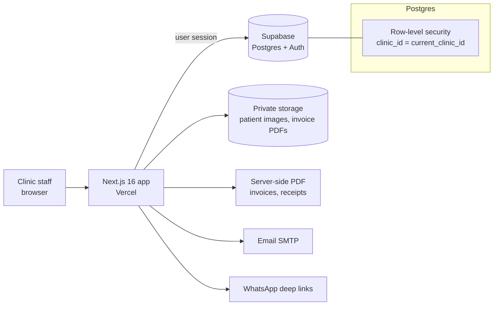

# Dental Clinic CRM

A practice-management CRM built for a dental clinic. This was a paid client project. The client's name, the clinic's data and every patient record are private. Nothing on this page comes from production data.

## Problem

The clinic ran patients, appointments, treatment quotes, invoices and payments across paper, spreadsheets and chat. The dentist needed a single place to see a patient's history and teeth, turn a quote into an invoice, take partial payments and send documents to patients without retyping anything.

## Solution

- **Patients:** list and profile with tabs for quotes, invoices, odontogram, photos (camera or file upload) and clinical notes. CSV export.
- **Odontogram:** per-tooth records using FDI tooth numbering.
- **Quotes to invoices:** line items, a quote that converts into an invoice, partial payments, balances and payment history.
- **Documents:** invoice and payment-receipt PDFs generated on the server, sent by email or shared through a pre-filled WhatsApp message.
- **Calendar and follow-ups:** appointments, a booking link and a follow-up list.
- **Settings:** a service catalogue with prices, plus doctor, booking and account details.
- **Login:** password reset by email, and error messages that tell "system unreachable" apart from "wrong password".

## Architecture



- **Multi-tenant by design.** Every table has row-level security keyed to the user's clinic, so a second clinic could run on the same database without seeing the first one's rows. Child tables are policed through their parent.
- **Private file storage** with per-clinic storage policies.
- **Pure domain logic** (payments, invoices, odontogram, auth errors) lives in plain TypeScript modules with no I/O, so it is unit-tested in isolation.
- Public sign-up is turned off: staff accounts are created by the admin.

## Code excerpts

Invoice status derived from totals, with no I/O:

```ts
export type InvoiceStatus = 'unpaid' | 'partial' | 'paid' | 'void';

/** Remaining balance on an invoice, never negative. */
export function invoiceBalance(total: number, paid: number): number {
  return Math.max(0, total - paid);
}

/**
 * Derive an invoice's payment status from its total and amount paid.
 * `void` is set explicitly by the user and is never derived here.
 */
export function invoiceStatusFor(total: number, paid: number): InvoiceStatus {
  if (paid <= 0) return 'unpaid';
  if (paid >= total) return 'paid';
  return 'partial';
}
```

Gapless invoice numbers per clinic and per year (INV-2026-0001), safe under concurrency, and unable to number another clinic's invoices:

```sql
create or replace function next_invoice_number(p_clinic uuid default null)
  returns table(out_seq int, out_year int, out_number text)
  language plpgsql security definer set search_path = ''
as $$
declare cid uuid := coalesce(p_clinic, public.current_clinic_id());
        y int := extract(year from now())::int;
        s int;
begin
  if cid is null then raise exception 'no clinic context'; end if;
  if public.current_clinic_id() is not null and cid <> public.current_clinic_id() then
    raise exception 'cannot number invoices for another clinic';
  end if;
  insert into public.invoice_counters(clinic_id, year, last_seq)
  values (cid, y, 1)
  on conflict (clinic_id, year)
    do update set last_seq = public.invoice_counters.last_seq + 1
  returning last_seq into s;
  return query select s, y, 'INV-'||y::text||'-'||lpad(s::text, 4, '0');
end; $$;
revoke execute on function next_invoice_number(uuid) from anon, public;
grant execute on function next_invoice_number(uuid) to authenticated;
```

The RLS helper is hardened the same way (`security definer`, empty `search_path`, no access for anonymous users):

```sql
create or replace function current_clinic_id() returns uuid
  language sql stable security definer set search_path = ''
as $$ select clinic_id from public.profiles where id = auth.uid(); $$;
revoke execute on function current_clinic_id() from anon, public;
```

## Stack

Next.js 16, React 19, TypeScript, Tailwind 4, shadcn/ui, zod, @react-pdf/renderer, Nodemailer, Supabase (Postgres, Auth, Storage, RLS), Vitest with Testing Library. Hosted on Vercel.

## Testing

46 test cases (Vitest, counted in source) cover the domain modules: invoices, payments, odontogram, account and auth errors.

## Lesson from production

The database runs on a free tier that pauses after about seven days without activity. When it paused, the login page showed "Invalid email or password", so the outage looked like a typo and went unnoticed.

The fix came in two steps:

1. A scheduled GitHub Action that probes the system three times a day and fails loudly, so an outage reaches me from CI instead of from the client. The login screen now tells "system unreachable" apart from "wrong password".
2. The first probe ran green while the database still paused: a failed sign-in counts as an Auth-service query, not user activity. The keep-alive now runs a real table read three times a day.

## My role

Sole builder: requirements with the client, design, development, deployment and hosting. I iterated on the invoicing flow from direct client feedback after go-live.

## Status

Delivered to the client in June 2026 and in use by the clinic.

## Screenshots

There are no screenshots here on purpose: every screen of the live app shows real patient data.
