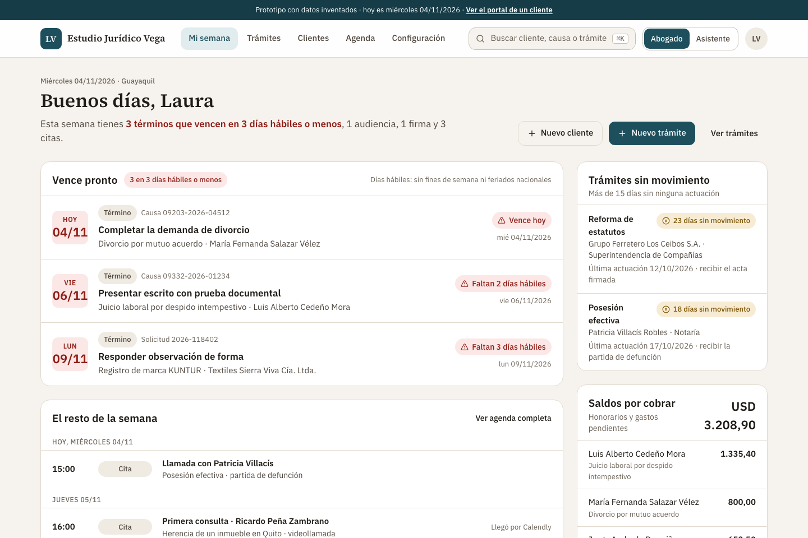
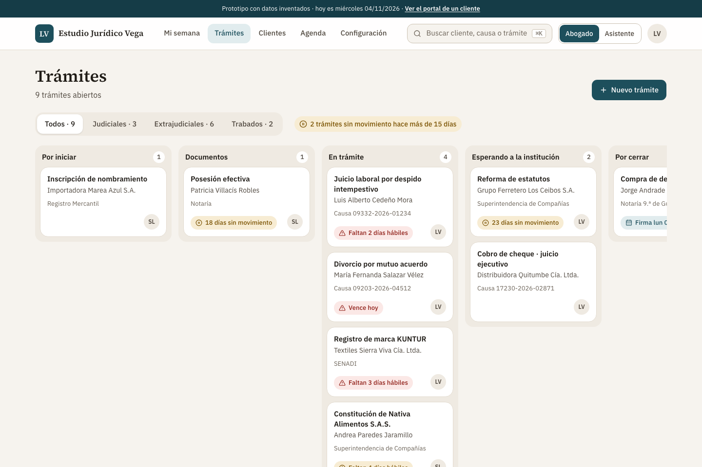
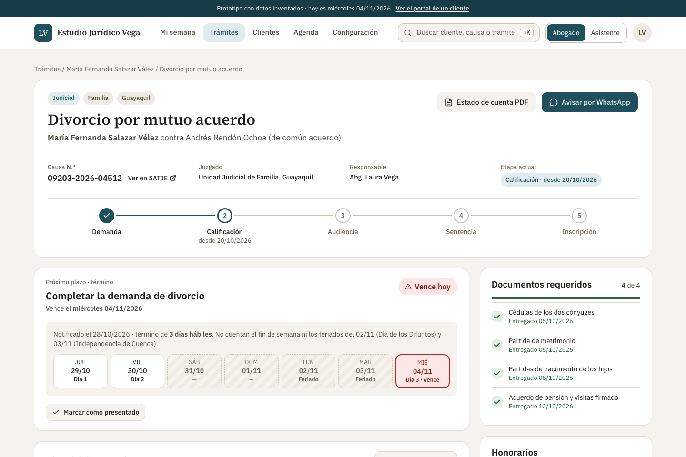
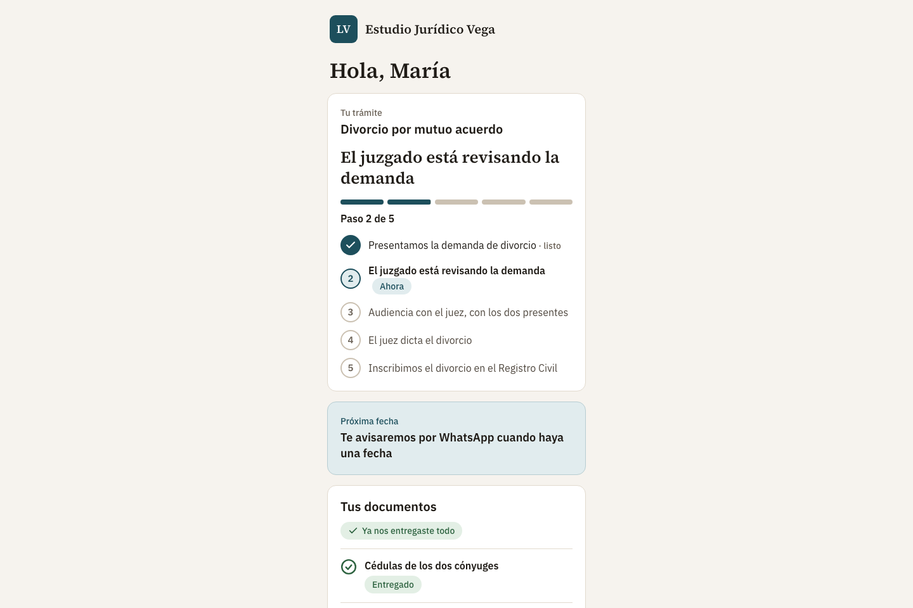

# Legal CRM Prototype

A clickable prototype of a case-management CRM for a small law firm in Ecuador. I built it to validate the workflow with a lawyer before writing any backend. The firm's name, the lawyer's name and every client in the screenshots are invented.



## Problem

A small firm runs dozens of open cases at once. Each one has a court or agency deadline counted in **business days** (no weekends, no national holidays), documents the client still owes, fees and expenses, and a client who keeps asking "how is my case going?" Missing a deadline is the expensive failure, and the work of chasing it stays invisible until it is too late.

## Solution

- **"My week":** deadlines due in three business days or fewer, the rest of the week's hearings, signings and meetings, cases with no movement for more than 15 days, and outstanding balances.
- **Case board:** each case moves through five stages (to start, documents, in progress, waiting on the institution, to close), with filters for court and out-of-court work and for stuck cases.
- **Case page:** stage tracker, next deadline with a day-by-day business-day count that skips weekends and holidays, required documents, fees, account statement as PDF and a one-click WhatsApp update for the client.
- **Client portal:** a private link where the client sees, in plain language, which step their case is on, what comes next and which documents are still missing.
- **Agenda, clients, roles (lawyer and assistant), global search (⌘K).**







## Business-day deadline engine

The core of the prototype is a small, dependency-free module that counts legal terms in business days:

```ts
export function esHabil(iso: string): boolean {
  const dia = aFecha(iso).getDay();
  return dia !== 0 && dia !== 6 && !FERIADOS[iso];
}

/** Date a term of `dias` business days falls due, counted from the notification. */
export function venceTermino(notificado: string, dias: number): string {
  let d = notificado;
  let contados = 0;
  while (contados < dias) {
    d = sumarDias(d, 1);
    if (esHabil(d)) contados++;
  }
  return d;
}

export type Urgencia = "vencido" | "hoy" | "urgente" | "pronto" | "normal";

/** Red if it falls due in 3 business days or fewer; amber from 4 to 7. */
export function urgencia(hoy: string, vence: string): Urgencia {
  if (vence < hoy) return "vencido";
  if (vence === hoy) return "hoy";
  const n = diasHabilesHasta(hoy, vence);
  if (n <= 3) return "urgente";
  if (n <= 7) return "pronto";
  return "normal";
}
```

## Stack

Next.js 16 (static export, no server and no database), React 19, TypeScript, Tailwind 4, shadcn/ui, cmdk. Hosted as a static site with strict security headers: a tight Content Security Policy, no framing, no indexing.

Data is typed mock data in the browser. Records the user creates are kept in local storage, so the prototype can be clicked through end to end without a backend.

## My role

Discovery with the lawyer, product design and the full build.

## Status

Prototype. The data is invented, there is no backend, and the demo login protects nothing. The next step, a real backend with authentication and row-level security, has not started.
