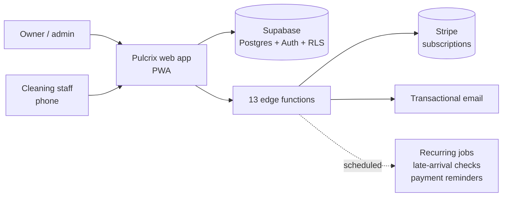

# Pulcrix

A SaaS for cleaning businesses in Australia (first called CleanFlow). It manages jobs, staff, clients, recurring work, time, invoices and subscriptions in one app. I built it as a solo founder, did not launch it to customers, and archived it in April 2026 to focus on Tab & Eat.

## Problem

Small cleaning companies run on spreadsheets, group chats and memory: who cleans which property today, which jobs repeat every week, who arrived late, how many hours each cleaner worked, and which clients still owe an invoice.

## Solution



- **Admin dashboard:** today's jobs as a Kanban board, urgent alerts, an activity feed and pending payments.
- **Jobs:** a step-by-step create-job wizard, a calendar, and recurring jobs generated automatically.
- **Clients and properties,** with price lists.
- **Staff:** invitations, roles, time tracking, pay rates and pay reports, plus late-arrival checks.
- **Billing:** invoices, invoice emails and automatic payment reminders.
- **Subscriptions:** Stripe checkout, customer portal, webhook and trial emails.
- **Installable PWA** for staff on their phones, with onboarding and multi-language support.

## Security work

About 50 SQL migrations, including passes that tightened access after automated security scanning. One example: views that join staff and client data were locked to signed-in users, as defence in depth on top of row-level security on the base tables.

```sql
-- Restrict view access to authenticated users only.
-- Even though security_invoker=on + base-table RLS blocks anon reads,
-- explicitly revoking access adds defense-in-depth.

-- profiles_public: employee names, emails, phones
REVOKE ALL ON public.profiles_public FROM anon, public;
GRANT SELECT ON public.profiles_public TO authenticated;

-- properties_staff_view: client addresses, property details
REVOKE ALL ON public.properties_staff_view FROM anon, public;
GRANT SELECT ON public.properties_staff_view TO authenticated;
```

## Stack

React 18, Vite 6, TypeScript, Tailwind 3, shadcn/ui (Radix), TanStack Query, React Router, react-hook-form with zod, FullCalendar, Recharts, jsPDF, Supabase (Postgres, Auth, Deno edge functions), Stripe, Sentry, vite-plugin-pwa. Quality: Vitest, Playwright, Husky with lint-staged, Prettier, and a CI pipeline that runs a dependency audit, the build and the tests.

The first version was scaffolded with Lovable and then extended by hand with AI-assisted development.

## My role

Solo founder: product design, the build, pricing and go-to-market planning.

## Status

Built, never launched to paying customers, archived in April 2026.
