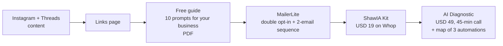

# ShawIA

My AI consulting and automation practice for Spanish-speaking small-business owners. The positioning is "operator, not guru": I only teach what I already run in my own businesses.

Links page: [shawia-links.vercel.app](https://shawia-links.vercel.app) · Kit: [whop.com/shawia/kit-shawia](https://whop.com/shawia/kit-shawia/)

## Problem

Small-business owners in Latin America hear that AI will change their business, but most of what reaches them is generic tips in English or hype. They need concrete prompts and automations for their own sales, content, customer service and operations, in Spanish.

## Solution: a small, honest funnel



- **Free guide:** "10 prompts para tu negocio en español", a 6-page PDF.
- **Email:** double opt-in form, then an automated two-email sequence: the guide first, the Kit two days later.
- **ShawIA Kit (USD 19):** the full set of prompt flows as PDF, .txt and .docx, with a 7-day refund window.
- **AI Diagnostic (USD 49):** a 45-minute call plus a written map of three automations for the client's business, delivered within two business days.

## Brand rules enforced as tests

The website's copy lives in one typed content file, and the brand rules are unit tests that fail the build. No em dashes, no agency-style "we'll automate your business" language, no fake urgency, and no mentions of my other company (excerpt, test names translated):

```ts
const strings = allStrings(content); // every string in the site's content

describe("hard brand rules in the content", () => {
  it("contains no em dash in any string", () => {
    const offenders = strings.filter((s) => s.includes("—"));
    expect(offenders).toEqual([]);
  });

  it("uses no automation-agency language", () => {
    const banned = /te automatizo|te monto la automatizaci|automatizamos tu negocio/i;
    const offenders = strings.filter((s) => banned.test(s));
    expect(offenders).toEqual([]);
  });

  it("uses no fake urgency", () => {
    const banned = /cupos limitados|agenda ya|últimos lugares|solo por hoy/i;
    const offenders = strings.filter((s) => banned.test(s));
    expect(offenders).toEqual([]);
  });
});
```

Other tests check that every call to action points to the right checkout, and that the WhatsApp link uses https.

## Stack

- Website: Next.js 16, React 19, TypeScript, Tailwind 4, Vitest; hosted on Vercel.
- Links page: a single static HTML page.
- Email: MailerLite (form, double opt-in, automation).
- Checkout and delivery: Whop.
- Content production and QA: my [AI agent system](../ai-agent-system/), with a separate reviewer agent that checks every piece before it is published.

## My role

Founder. I wrote the offers, the guide and the Kit, designed and built the website and the funnel, and run the content.

## Status

The funnel is live end to end: links page, guide, email sequence, Kit and Diagnostic. I have no sales figures worth publishing yet.
