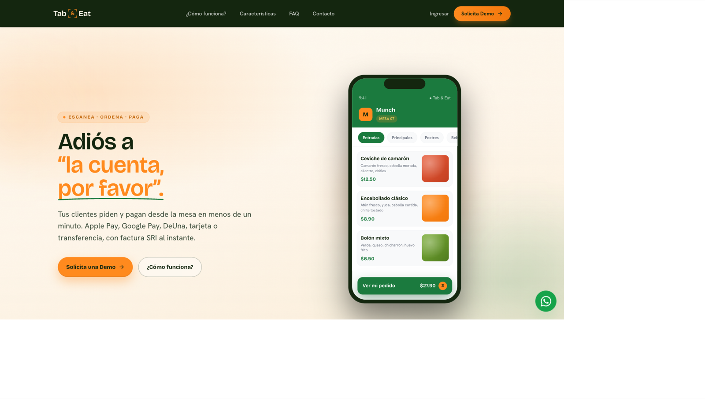
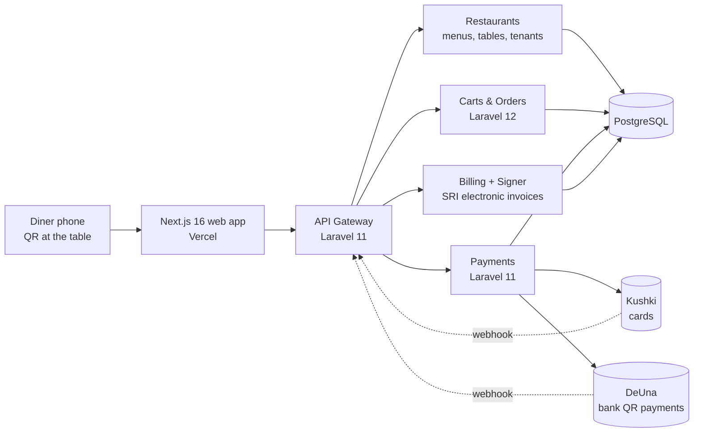
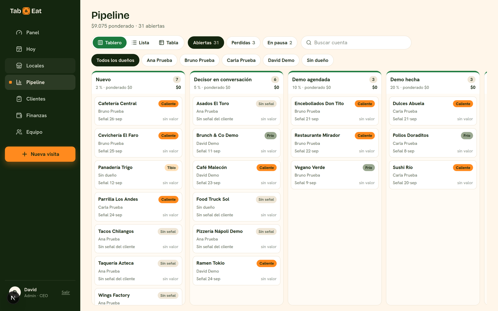

# Tab & Eat

**Scan, order and pay from the table.** ("Escanea, pide y paga")

Website: [tabandeat.com](https://tabandeat.com)



## Problem

In Ecuador, restaurants lose time and money at two moments: waiting for the bill at the table, and paying high commissions on every order that comes through delivery apps. Diners wait to order and wait to pay, and owners hand a cut of each delivery order to the platform.

## Solution

Tab & Eat gives each restaurant its own ordering and payment channel.

- **Diner:** scans the QR on the table and opens the restaurant's menu at `tabandeat.com/<restaurant>/mesa/<n>`. They browse categories and promos, pick modifiers and notes, add a tip, choose an invoice type (final consumer or tax ID) and pay by card, Apple Pay, Google Pay, DeUna or bank transfer. The order reaches the kitchen once it is paid, and the diner follows it on screen (received, preparing, ready).
- **Restaurant staff:** an admin panel to manage menus, tables, orders and cancellations, with role-based access.
- **Owner:** a delivery channel of their own, for a fixed monthly fee instead of a commission on every order.

## Architecture



- Six Laravel services on Railway behind a single API gateway, sharing a PostgreSQL database. Background work runs on database-backed queues.
- Next.js 16 / React 19 front end on Vercel, with Sentry for error tracking.
- Multi-tenant: each restaurant is a tenant, with its own payment credentials resolved per tenant.
- Production changes go through a pull request reviewed by the technical lead before deploy. No exceptions for the founder.

## Payments engineering

Payments use a strategy pattern, with one strategy per method (card, Kushki, Kushki transfer, DeUna, cash, bank transfer). Two design decisions matter most:

**1. Claim, then charge.** A charge row is inserted with a unique idempotency key *before* the gateway is called, so the unique index acts as the lock. Two concurrent requests with the same key cannot both charge the card: the second one collides on insert and replays the stored result.

**2. Never mark an uncertain payment as failed.** If the gateway call dies without an answer, the payment stays pending. A signed webhook or a reconciliation job closes it later.

Excerpt from the Payments service (trimmed):

```php
// Idempotency as CLAIM-then-charge, not check-then-act.
// The INSERT comes first and the unique index on idempotency_key IS the
// mutex: the loser of the race collides here, before touching Kushki,
// and replays instead.
try {
    $payment = Payment::create([
        'branch_id'       => $order->resolveBranchId(),
        'method'          => PaymentService::PAYMENT_METHOD_KUSHKI_CARD,
        'payment_type'    => PaymentService::PAYMENT_TYPE_ORDER,
        'status'          => PaymentService::STATUS_PENDING,
        'value'           => $amount,
        'idempotency_key' => $validated['idempotency_key'],
    ]);
} catch (QueryException $e) {
    if (!$this->isUniqueViolation($e)) {
        throw $e;
    }
    return $this->replayKushkiCharge($order, $validated['idempotency_key']);
}

try {
    $result = app(KushkiPayment::class)->processPayment($amount, $validated);
} catch (\Throwable $e) {
    // Leave the row PENDING on purpose: the request died without an
    // answer, so we do NOT know whether the money moved. Marking it
    // FAILED here would lie. The webhook or the reconcile job closes it out.
    Log::error('Kushki charge: gateway threw, payment left pending', [
        'payment_id' => $payment->id,
        'order_id'   => $order->id,
    ]);
    // ...
}
```

Webhook signature check (HMAC-SHA256, constant-time compare, per-tenant secret):

```php
private function verifySignature(string $body, ?string $signature, ?string $simpleSignature, ?string $kushkiId, string $secret): bool
{
    if ($secret === '' || $kushkiId === null) {
        return false;
    }
    if ($signature !== null) {
        $expected = hash_hmac('sha256', $body . '.' . $kushkiId, $secret);
        if (hash_equals($expected, $signature)) {
            return true;
        }
    }
    if ($simpleSignature !== null) {
        $expected = hash_hmac('sha256', $kushkiId, $secret);
        return hash_equals($expected, $simpleSignature);
    }
    return false;
}
```

The service has feature tests for charge idempotency, refund guards and the webhook payload whitelist.

---

## Internal sales CRM

A separate app the sales team uses every day for street visits, pipeline, proposals, follow-ups and collections. It is deliberately isolated from the production platform, so sales tooling can move fast without touching the payment path.


*Pipeline board. Screenshot taken with fictional demo data.*

**Features**

- Street-visit form with a mandatory photo, plus a visit map.
- Pipeline with nine stages (new, decision-maker, demo booked, demo done, proposal, negotiation, agreed, paying, active) on a drag-and-drop board.
- Activities (visit, call, WhatsApp, email, demo, note), follow-ups with reassignment, weekly goals per seller.
- Proposals, collections and subscriptions; duplicate detection; owner changes with an audit log.
- Push reminders and offline drafts for sellers on the street.
- Read-only access for an AI sales agent through a token-checked database function (only a hash of the token is stored).

**Stack:** Next.js 16 (App Router, server actions), React 19, TypeScript, Supabase (Postgres, Auth, Storage), Tailwind 4, zod, Leaflet, web-push. Tests: Vitest (unit, plus integration tests against a real Postgres + PostgREST) and Playwright.

**Security model:** there is no service-role key in the app. Every write runs with the user's own session, and permissions live in Postgres: row-level security plus `security definer` functions in a private schema. Roles: admin, seller, ops.

Excerpt: a seller can read and edit only their own opportunities and unowned ones (comments translated):

```sql
-- "Free" for a seller: no owner, or another seller's reservation has expired,
-- and not imported from another seller or owned by the admin.
create function privado.cuenta_libre(p_cuenta uuid) returns boolean
language sql stable security definer set search_path = public as $$
  select exists (
    select 1 from cuentas c
    where c.id = p_cuenta and c.dueno_legado is null
      and (c.dueno_id is null
           or (c.reservada_hasta < current_date
               and not exists (select 1 from perfiles p where p.id = c.dueno_id and p.rol = 'admin')))
  );
$$;
revoke all on function privado.cuenta_libre(uuid) from public, anon;
grant execute on function privado.cuenta_libre(uuid) to authenticated;

create policy oportunidades_leer on oportunidades for select to authenticated using (
  (select privado.es_admin_u_ops())
  or ((select privado.es_activo()) and (privado.es_dueno(cuenta_id) or privado.cuenta_libre(cuenta_id)))
);
-- Sellers never create or edit opportunities directly: a logged activity advances them.
create policy oportunidades_crear on oportunidades for insert to authenticated
  with check ((select privado.es_admin_u_ops()));
```

The permission tests include a control: permissions are broken on purpose, and the suite must go red.

**Size of the test suites (counted in source):** 330 Vitest test cases and 27 Playwright tests.

---

## My role

Founder and CEO. I own the product, sales, the sales team, pricing and the payment partnerships (Kushki, DeUna). I write the specs and success criteria, and I build with an AI-assisted engineering workflow. A technical lead reviews every production change before it ships. I built the internal CRM end to end.

## Status

- Platform: live in production at tabandeat.com, with paying restaurants in Ecuador. Kushki and DeUna are both live.
- CRM: in daily use by the sales team.
